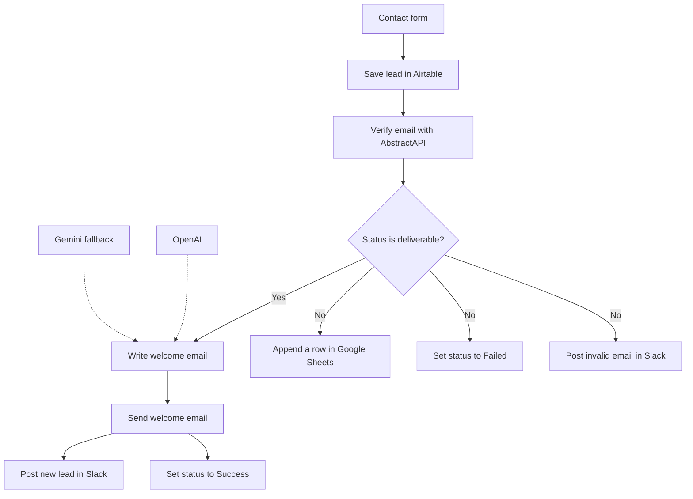

# Customer Lead Automation

An n8n workflow for new leads. A person submits a short contact form. The run stores the lead, checks that the email can receive mail, and then either sends a personal welcome or records the address as not deliverable.

n8n hosts the form and runs every step.

## Image 


## Flow



Gmail runs first on a deliverable address. Slack and the Success status run only after Gmail accepts the message. The three false-branch nodes run together.

| Node | What it does |
| --- | --- |
| On form submission | Collects Name, Email, and Interest. All three are required. |
| Save lead | Creates the Airtable row, including the form timestamp. |
| Verify email | Calls AbstractAPI Email Reputation. The API key stays in an n8n credential. |
| Email deliverable? | Continues only when `email_deliverability.status` is `deliverable`. |
| AI Agent | Writes the welcome from the lead's name and interest. |
| OpenAI | Primary model, `gpt-4.1-mini`. |
| Gemini | Fallback model. Used only if OpenAI fails. |
| Send welcome email | Sends the agent's text from Gmail. |
| Notify new lead | Posts the lead to Slack. |
| Mark success | Sets Airtable `Status` to `Success`. |
| Append error log | Adds the lead to Google Sheets. |
| Mark failed | Sets Airtable `Status` to `Failed`. |
| Notify invalid email | Posts to Slack that no email was sent. |

`undeliverable` and `unknown` both take the false branch. If AbstractAPI itself errors, the run stops on Verify email, so an outage is not stored as a bad address. If Gmail fails, `Status` stays blank and the execution shows as failed.

## Email

The agent is told to write 80–140 words, use the person's name, mention their interest once, offer help, and invite a reply. The sign-off is:

```
Best regards,
Hafizflow Team
```

The subject is set on the Gmail node, not by the model:

```
Welcome, <name> 👋 Let's get started
```

n8n's "sent with n8n" line is turned off.

## Project layout

```
.
├── docker-compose.yml
├── workflows/customer-lead-automation.json
├── LICENSE
└── README.md
```

`workflows/customer-lead-automation.json` is the file you import. Base, table, channel, and spreadsheet ids in that file are placeholders (`YOUR_AIRTABLE_BASE_ID` and the same pattern). Credential ids are placeholders too. You point each node at your own accounts after import.

## Before you import

- An n8n instance. Use the one you already have, or start one with Docker below.
- An Airtable base with a table that has these single-line text fields: `Name`, `Email`, `Interest`, `Submitted At`, `Status`.
- A Slack channel the bot can post in.
- A Gmail account that will send the welcome.
- A Google Sheet whose first row is `Name`, `Email`, `Interest`, `Status`.
- An OpenAI API key and a Google Gemini API key.
- An [AbstractAPI Email Reputation](https://www.abstractapi.com/api/email-reputation-api) key.

AbstractAPI, OpenAI, and Gemini bill by use. Check the current free tier on each before you leave the workflow active.

## Run n8n locally

Skip this if you already have n8n.

```bash
docker compose up -d
```

Open [http://localhost:5678](http://localhost:5678) and create the owner account. n8n keeps that data in the `n8n_data` volume. Stop it with:

```bash
docker compose down
```

## Import

1. In n8n, open the workflow list and choose **Import from File**.
2. Select `workflows/customer-lead-automation.json`.
3. Create the credentials below and select them on the matching nodes.
4. On every Airtable node, choose the same base and the same table. Replace `YOUR_AIRTABLE_BASE_ID` and `YOUR_AIRTABLE_TABLE_ID`.
5. On both Slack nodes, choose the channel. Replace `YOUR_SLACK_CHANNEL_ID`.
6. On Append error log, choose the spreadsheet. The sheet id `gid=0` is the first tab. Replace `YOUR_GOOGLE_SHEET_ID` if you want a different file.
7. Open Gemini and pick a model if the node does not already show one.
8. Save, then activate the workflow.
9. Open **On form submission** and copy the production form URL.

### Credentials

| Nodes | n8n credential | What to enter |
| --- | --- | --- |
| Verify email | Query Auth, named AbstractAPI Email Reputation | Parameter name `api_key`. Value is your AbstractAPI key. Leave the URL as it is. |
| Save lead, Mark success, Mark failed | Airtable Personal Access Token | A token that can read and write records and read base schema. Use the same credential on all three nodes. |
| Notify new lead, Notify invalid email | Slack API | A bot token with `chat:write` and access to the channel. |
| Send welcome email | Gmail OAuth2 | The mailbox that sends the welcome. |
| Append error log | Google Sheets OAuth2 | An account that can edit the error sheet. |
| OpenAI | OpenAI API | Your OpenAI key. |
| Gemini | Google Gemini API | Your Gemini key. |

The Query Auth credential sends `api_key` on the request. The node adds `email` itself from the Airtable row. Do not paste the key into the URL.

## Try it

Submit the production form with a real inbox you can open:

| Field | Example |
| --- | --- |
| Name | Ayesha Rahman |
| Email | an address you can open |
| Interest | Web application development |

You should get the welcome email, a Slack post, and `Success` on that Airtable row.

Submit again with an address that cannot receive mail, such as `not-a-real-inbox@example.com`. You should get a Sheets row with status `Email not deliverable`, Airtable `Failed`, a Slack post, and no welcome email.

## If a run looks wrong

- The form returns a recorded message, but nothing else happens: the workflow is not active, or the form URL is the test URL while you are looking at production executions.
- Verify email fails immediately: the Query Auth credential is missing, or the parameter is not named `api_key`.
- The lead is always marked Failed: open the Verify email output and read `email_deliverability.status`. Only the exact value `deliverable` takes the true branch.
- Slack and Success never run: Gmail did not finish. Those two nodes are downstream of Send welcome email.
- Airtable says it cannot match the row: Mark success and Mark failed must use the same base and table as Save lead, matched on record `id`.

## License

MIT. See [LICENSE](LICENSE).
